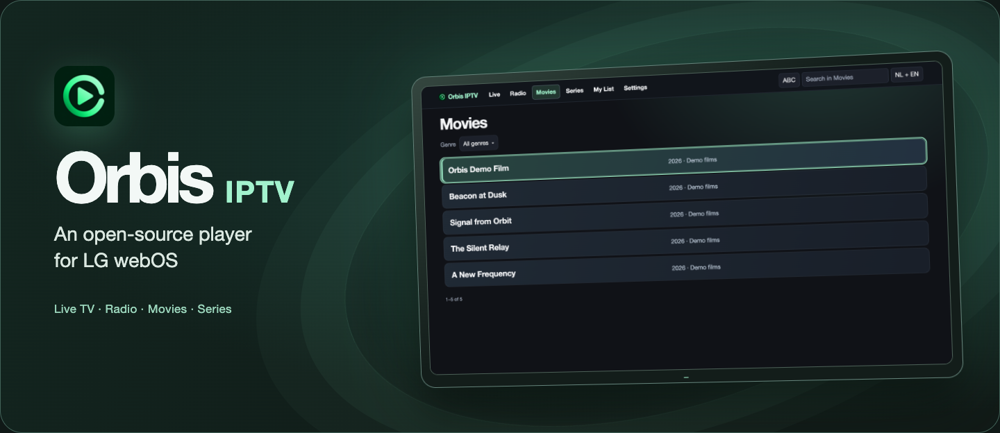
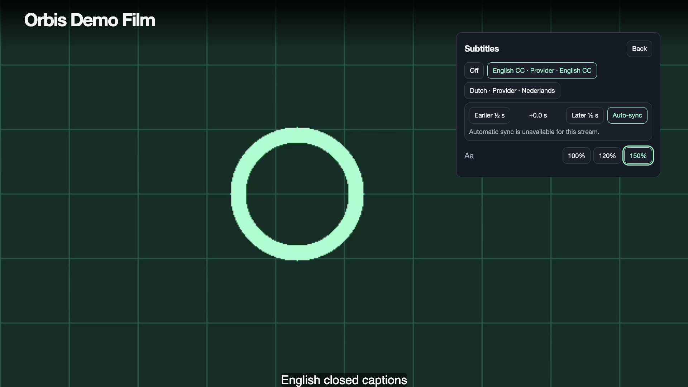

# Orbis IPTV



[](https://github.com/dedmen7/webos-iptv-rs/releases/latest)
[](https://github.com/dedmen7/webos-iptv-rs/actions/workflows/check.yml)
[](LICENSE)

Orbis is an open-source IPTV player for **LG webOS 5.0 and later**. Its Rust/WebAssembly core handles the catalog, search, program guide, and subtitle matching. Playback uses the TV’s media engine. Add your own M3U playlist or Xtream account to get started.

[Download the `.ipk`](https://github.com/dedmen7/webos-iptv-rs/releases/latest) · [Install on your TV](#install-on-an-lg-tv) · [Build from source](#build-from-source)

## What you can do

- Browse live TV, radio, movies, and series with your remote. Search movies and series separately and filter by genre.
- Open a quick program guide during live TV and see what is on now and next when guide data is available.
- Resume movies and episodes, mark titles as watched, and save movies and series to My List.
- Choose Dutch or English subtitles, including English CC where available. Add OpenSubtitles and SubDL in Settings to search online.
- Resize subtitles to **100%, 120%, or 150%** and adjust their timing in half-second steps. Orbis remembers your size, subtitle selection, and timing corrections. Automatic timing depends on whether the stream exposes audio to the app.
- Hide the playback controls with **Back**, even while paused. Press **OK** to show them again.

<details>
<summary>See the subtitle controls</summary>



</details>

Orbis follows the TV language for English, Dutch, German, and French. Sources and viewing progress are stored on the TV. Orbis contacts the configured media and subtitle providers directly.

## Install on an LG TV

1. Download the `.ipk` from [GitHub Releases](https://github.com/dedmen7/webos-iptv-rs/releases/latest).
2. Enable Developer Mode and pair your TV with a computer on the same network. Follow [LG’s Developer Mode guide](https://webostv.developer.lge.com/develop/getting-started/developer-mode-app).
3. Install the `.ipk` with the LG webOS CLI. In the commands below, replace `lg-tv` with the name you paired and use the filename you downloaded.

   ```sh
   ares-install --device lg-tv ./com.dedmen7.orbisiptv_0.1.57_all.ipk
   ares-launch --device lg-tv com.dedmen7.orbisiptv
   ```

4. Open **Orbis IPTV**, choose **M3U link** or **Xtream account**, enter your provider details, and select **Save**.

The release also includes an installation guide in English, Dutch, German, and French. Developer Mode sessions expire. Extend the session in the LG Developer Mode app to keep using sideloaded apps. Compatibility can vary by TV model and stream codec.

## Build from source

```sh
rustup toolchain install 1.96.0 --profile minimal
rustup toolchain install nightly-2026-11-26 --profile minimal \
  --component rust-src --target wasm32-unknown-unknown
cargo +1.96.0 install wasm-bindgen-cli --version 0.2.130 --locked
npm install -g esbuild @webos-tools/cli
cargo +1.96.0 run --locked --bin package
```

The package is written to `target/package/`. Pass `-- --web-only` to build the web bundle in `dist/`.

## Contributing

Use [GitHub Issues](https://github.com/dedmen7/webos-iptv-rs/issues) for bugs and feature requests. For a playback issue, include your Orbis and webOS versions, TV model, source type, and steps to reproduce. Use a demo source or redact credentials and provider URLs from logs and screenshots.

Orbis is licensed under [Apache 2.0](LICENSE).
